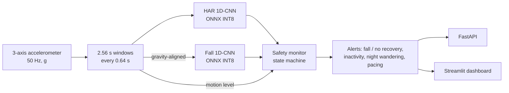

# SafeStep HAR

Wearable human activity recognition for dementia patient safety: activity classification, fall detection and caregiver alerts, quantized to run on a low-power device, with an API and a caregiver dashboard.

> Independent reimplementation of the HAR approach I worked on during my internship at DemCare Healthcare Solutions, built entirely on public datasets. No company code or patient data is included.



## Quickstart (copy, paste, run)

**1. Set up** (Python 3.10 to 3.13)

```bash
git clone <your-repo-url> safestep-har && cd safestep-har
python -m venv .venv
source .venv/bin/activate            # Windows: .venv\Scripts\activate

# CPU-only machine: install the small CPU build of PyTorch first (skip if you have a GPU)
pip install torch --index-url https://download.pytorch.org/whl/cpu
pip install -r requirements.txt
```

**2. Check everything works: no downloads, 5 to 10 minutes on a laptop CPU**

```bash
pytest -q                            # 53 tests, every stage covered
python run_all.py --smoke            # whole pipeline on synthetic data -> outputs_smoke/
python run_all.py --smoke --serve dashboard
```

Smoke mode writes synthetic recordings in the exact UCI HAR, SisFall and PAMAP2 file formats, then runs every real script on them. It checks the plumbing only, so its numbers mean nothing.

**3. Real run**

```bash
python run_all.py                    # downloads UCI HAR + PAMAP2, trains, exports, builds the replay
```

SisFall has no stable direct link, so the script stops and prints where to get it. Put it at `data/raw/SisFall_dataset/SA01/...`, then continue:

```bash
python run_all.py --stages fall deploy export demo report
```

All tables land in `outputs/RESULTS.md`. Copy them into the results sections below. Full CPU training takes a few hours; a free Colab GPU is much faster (scripts pick up CUDA automatically). Run single stages with `--stages`, for example `--stages deep`.

**4. Serve**

```bash
python run_all.py --serve dashboard  # http://localhost:8501
python run_all.py --serve api        # http://localhost:8000/docs
docker compose up --build            # both, in a slim image with no PyTorch
```

## Status

| Week | Stage | Status |
|---|---|---|
| 1 | Data pipeline: UCI HAR, PAMAP2 (wrist IMU), SisFall loaders, windowing, features | Done |
| 2 | Feature baselines (Random Forest, XGBoost) with subject-wise CV | Done |
| 3 | Deep models (1D-CNN, CNN-LSTM, transformer), augmentation, ablations | Done |
| 4 | Fall detection with event-level metrics + caregiver safety rules | Done |
| 5 | ONNX export, INT8 quantization, latency benchmarks, numpy-only runtime | Done |
| 6 | Replay of a simulated day, FastAPI service, Streamlit dashboard, Docker, CI | Done |

## Evaluation protocol

All results use **subject-wise splits** (GroupKFold over subject IDs), so no person appears in both train and test. Random window splits leak subject identity and inflate scores, so they are not reported. Deep models also hold out separate *training* subjects for early stopping, so test subjects never influence checkpoint selection. Every split has an assertion that fails on subject leakage.

Metrics: macro-F1 (primary), accuracy, per-class F1, confusion matrix.

## Week 1-2: Data and baselines

Every loader returns the same schema, so models never depend on a specific dataset:

- `X`: float32 `(n_windows, window_len, n_channels)`, 2.56 s windows at 50 Hz
- `y`, `subjects`, `channels`, `classes`

| Dataset | Use | Notes |
|---|---|---|
| UCI HAR | Main HAR benchmark, 30 subjects, 6 activities | Waist smartphone |
| PAMAP2 | Wrist-worn HAR, 9 subjects, 12 activities | Wrist IMU (+ optional heart rate), 100 Hz downsampled, windowed per continuous activity run |
| SisFall | Falls (23 young adults) and ADLs (+15 elderly) | 200 Hz downsampled |

Hand-crafted features: per-channel time and frequency statistics, orientation-independent magnitude signals, signal magnitude area, axis correlations.

| Model | Dataset | Macro-F1 (subject-wise CV) |
|---|---|---|
| Random Forest | UCI HAR | _run to fill_ |
| XGBoost | UCI HAR | _run to fill_ |
| Random Forest | PAMAP2 wrist | _run to fill_ |
| XGBoost | PAMAP2 wrist | _run to fill_ |

## Week 3: Deep models

| Model | Idea | Why it is here |
|---|---|---|
| `cnn1d` | 3 conv blocks + global average pooling | Small and quantization friendly, the on-device model |
| `cnn_lstm` | Conv feature extractor + 2-layer LSTM | Models the order of motion patterns |
| `transformer` | Strided-conv patch tokens + 2 encoder blocks | Tests whether attention helps on short IMU windows |

- Augmentation on raw signals before normalization: random 3D rotation of each sensor triplet (the device sits differently on each person), magnitude scaling, jitter.
- Class-weighted cross-entropy with label smoothing, AdamW, cosine schedule, gradient clipping.
- Each run reports parameter count and single-window CPU latency.

| Model | Dataset | Macro-F1 | Params | CPU ms/window |
|---|---|---|---|---|
| 1D-CNN | UCI HAR | _run to fill_ | | |
| CNN-LSTM | UCI HAR | _run to fill_ | | |
| Transformer | UCI HAR | _run to fill_ | | |
| 1D-CNN | PAMAP2 wrist | _run to fill_ | | |

| Ablation | Question | Macro-F1 (cnn1d) |
|---|---|---|
| All 9 channels | Baseline | _run to fill_ |
| Accelerometer only | Is the cheapest sensor enough? | _run to fill_ |
| No augmentation | Does rotation/scale augmentation help across people? | _run to fill_ |

## Week 4: Fall detection and safety rules

- **Event-level evaluation, not window accuracy.** The detector slides over whole recordings (0.5 s hop), nearby positive windows merge into one alarm (10 s refractory), and a fall only counts if an alarm overlaps the impact. Reported as **fall recall** and **false alarms per hour**, which is what a caregiver actually experiences.
- **Threshold chosen on validation subjects** to reach 95% recall with the fewest false alarms. Missing a fall costs more than a false alarm.
- **False alarms reported separately for elderly participants.**
- **Impact-shift augmentation** so the model doesn't learn "spike in the middle = fall".
- **Classic baseline:** impact above 2.5 g followed by stillness.

| Detector | Fall recall | False alarms / h (all ADL) | False alarms / h (elderly ADL) |
|---|---|---|---|
| CNN, threshold tuned for 95% recall | _run to fill_ | | |
| CNN, threshold 0.5 | _run to fill_ | | |
| Impact + stillness rule | _run to fill_ | | |

`outputs/fall/fall_tradeoff.png` plots recall against false alarms per hour.

The safety monitor (`src/safety/monitor.py`) is a streaming state machine over model outputs:

| Alert | Severity | Rule (defaults, configurable in `SafetyConfig`) |
|---|---|---|
| `FALL_SUSPECTED` | high | Fall probability above the tuned threshold |
| `FALL_NO_RECOVERY` | critical | Suspected fall followed by 30 s without movement |
| `FALL_RECOVERED` | info | Upright and moving for 5 s after a suspected fall |
| `INACTIVITY_CHECK` | medium | No movement for 2 h during the day (night stillness is sleep) |
| `NIGHT_WANDERING` | medium | 5+ min of walking within 30 min, 22:00 to 06:00 |
| `RESTLESS_PACING` | low | 6+ walking bouts within 30 min (daytime) |

Per-type cooldowns prevent alert storms, and a data gap over 5 minutes resets short-term state so a stale fall never resolves hours later.

## Week 5: Edge deployment

`src/export/onnx_export.py` turns a checkpoint into a deployable model:

1. Normalization and softmax are baked into the graph: raw sensor window in, probabilities out.
2. FP32 ONNX export, verified against PyTorch outputs.
3. INT8 post-training quantization: static (QDQ, per-channel, calibrated on training subjects) and dynamic are both tried, and the smallest model that agrees with FP32 on at least 98% of calibration windows is kept.
4. Benchmark on the checkpoint's held-out test subjects: size, single-thread batch-1 latency, macro-F1, INT8-vs-FP32 agreement.

The transformer uses hand-written attention (Linear + matmul) because `nn.MultiheadAttention` exports to a graph that INT8 quantizers handle poorly (it barely shrank; the rewrite is about 2.5x smaller). `src/export/runtime.py` needs only numpy and onnxruntime.

| Model | Variant | Size (KB) | Latency p50 (ms) | Macro-F1 |
|---|---|---|---|---|
| On-device HAR (acc-only 1D-CNN) | ONNX FP32 | _run to fill_ | | |
| On-device HAR (acc-only 1D-CNN) | ONNX INT8 | _run to fill_ | | |
| Fall detector (acc-only 1D-CNN) | ONNX FP32 | _run to fill_ | | |
| Fall detector (acc-only 1D-CNN) | ONNX INT8 | _run to fill_ | | |

Latency is measured on the dev machine's CPU with one thread. Rerun the export on the target device (for example a Raspberry Pi) for real on-device numbers.

## Week 6: Replay, API and dashboard

**One sensor, two models.** The deployed pair (`configs/deploy_har.yaml`, `configs/fall_acc_only.yaml`) both use only the 3-axis accelerometer in g, the cheapest sensor with the longest battery life.

**Gravity-based frame alignment.** UCI HAR and SisFall devices point their axes differently, and a model only works in the frame it was trained in. `src/demo/frames.py` estimates each frame's "up" direction from upright periods and rotates between them. On a real device this is a one-off calibration: stand still for a few seconds.

**Simulated day** (`src/demo/session.py`): activity segments from a UCI HAR subject the HAR model never saw, plus a real SisFall fall from a held-out subject. The scenario triggers every alert type:

| Time | Part | Expected alerts |
|---|---|---|
| 08:00 | Morning routine | none |
| 10:30 | Fall in the hallway | `FALL_SUSPECTED`, then `FALL_NO_RECOVERY` |
| 14:00 | Afternoon restlessness | `RESTLESS_PACING` |
| 23:30 | Night wandering | `NIGHT_WANDERING` |

**Dashboard** (`app/dashboard.py`): alert log with severity, replay slider, predicted vs ground-truth activity timeline, fall probability with threshold and alert markers, motion level, daily summary, and model size and latency.

**API** (`app/api.py`, docs at `/docs`):

| Endpoint | Purpose |
|---|---|
| `GET /health` | Model status, classes, fall threshold |
| `POST /predict` | Classify one window (stateless) |
| `POST /devices/{id}/ingest` | Classify and update that device's safety monitor, returns new alerts |
| `GET /devices/{id}/summary` | Time per activity and alert history |
| `DELETE /devices/{id}` | Reset a device |

Example request (macOS/Linux shell; on Windows use the interactive `/docs` page):

```bash
curl -X POST localhost:8000/predict -H "Content-Type: application/json" \
     -d "{\"window\": $(python -c 'print([[1.0, 0.0, 0.0]] * 128)')}"
```

## Project structure

```
run_all.py          one command for the whole pipeline (--smoke, --stages, --serve)
configs/            experiment configs (one YAML per run)
data/download.py    dataset downloads (raw data is gitignored)
src/data/           loaders (UCI HAR, PAMAP2, SisFall), windowing, features, synthetic data
src/models/         1D-CNN, CNN-LSTM, transformer
src/augment.py      rotation / scaling / jitter for IMU windows
src/train_*.py      baseline, deep and fall training with subject-wise CV
src/fall/           stream inference, alarm merging, event metrics, rule baseline
src/safety/         caregiver alert state machine + daily summary
src/export/         ONNX export, INT8 quantization, benchmarks, numpy-only runtime
src/demo/           frame alignment, simulated-day builder, stream processor
app/                FastAPI service and Streamlit dashboard
tests/              unit + integration tests on synthetic data (no download needed)
Dockerfile          slim serving image (ONNX Runtime, no PyTorch)
```

## Limitations

- Public datasets are recorded in lab or semi-controlled settings with healthy, mostly young participants. Nothing here is clinically validated for dementia patients.
- SisFall falls are simulated by young adults onto mats. Real falls in older adults are slower and more varied.
- SisFall ADL recordings are short and include deliberately demanding activities, so false alarms per hour are likely pessimistic compared with a normal day.
- The replay stitches two datasets recorded with different devices. Gravity alignment fixes the up direction but not yaw. A real deployment would train both models on data from the same device.
- Safety rule thresholds are sensible defaults, not clinically derived. In practice they would be tuned per patient with caregivers.

## Datasets

- UCI HAR: Anguita et al., 2013, UCI Machine Learning Repository
- PAMAP2: Reiss and Stricker, 2012, UCI Machine Learning Repository
- SisFall: Sucerquia, López and Vargas-Bonilla, 2017, *Sensors* 17(1):198
